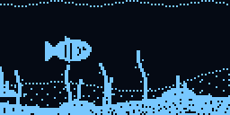

# Acuario

Un pez que avanza sin parar por el fondo del mar, en el OLED de la LoRa32.



- **El pez** mueve la cola, sube y baja tranquilo y suelta burbujas. Parece que avanza porque el fondo
  se desplaza.
- **El fondo**, en capas a distinta velocidad:
  - dunas lejanas que se mueven despacio y casi no cambian;
  - rocas y algas que se mecen;
  - suelo de arena;
  - superficie con olas.
- **Encuentros:** cada 6-14 s cruza un animal al azar:
  - una **medusa** que flota a la deriva;
  - una **tortuga** que nada hacia el pez;
  - un **banco de peces**;
  - un **cangrejo** que camina por la arena;
  - un **tiburón** que pasa rápido.

  Si un animal se le acerca, el pez se aparta.
- **Botón BOOT:** hace salir un animal al momento.

```bash
cd Acuario
pio run -e acuario -t upload        # LoRa32 V2.1 (T3 V1.6.x)
pio run -e acuario_v1 -t upload     # LoRa32 V1.0
pio run -e acuario -t upload        # o desde la raíz del repositorio
```

No usa la radio LoRa ni la WiFi.

## Ajustes (`src/escena.cpp`)

| Constante | Qué hace |
|-----------|----------|
| `VEL_FONDO` | Velocidad a la que «avanza» el pez (px/s) |
| `VEL_LEJOS` | Velocidad de las dunas lejanas |
| `ENCUENTRO_MIN` / `ENCUENTRO_MAX` | Segundos entre animales |
| `FPS` (en `main.cpp`) | Fotogramas por segundo (30) |

Toda la escena está en `escena.cpp` y usa solo la API en C de U8g2. El mismo código compila en el ordenador,
y así se ha generado la vista previa.
