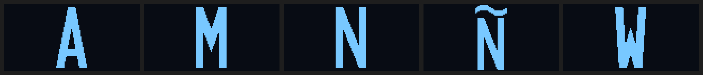

# Alfabeto

Muestra en el OLED de la LoRa32 una letra mayúscula cada 3 segundos (A, B, C… Ñ… Z, y vuelve a empezar),
lo más grande posible: fuente Logisoso de **58 px de alto** en una pantalla de 64 px.

```bash
cd Alfabeto
pio run -e alfabeto -t upload        # LoRa32 V2.1 (T3 V1.6.x)
pio run -e alfabeto_v1 -t upload     # LoRa32 V1.0
```

No usa la radio LoRa ni la WiFi. Solo necesita la placa y el cable USB.



- **Ritmo:** cambia `INTERVALO_MS` en `src/main.cpp`.
- **Letras:** cambia la cadena `LETRAS` (por ejemplo, para quitar la Ñ).
- **La Ñ:** la fuente grande no la incluye. Se dibuja con una «N» de 50 px y una virgulilla trazada encima,
  así que sale algo más baja que el resto.
